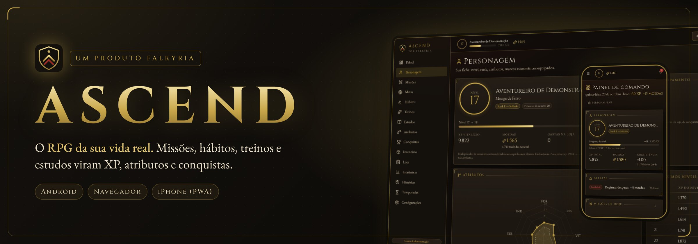
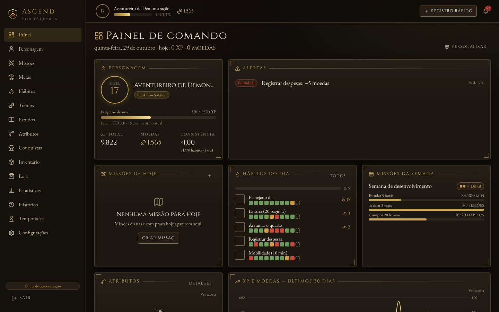
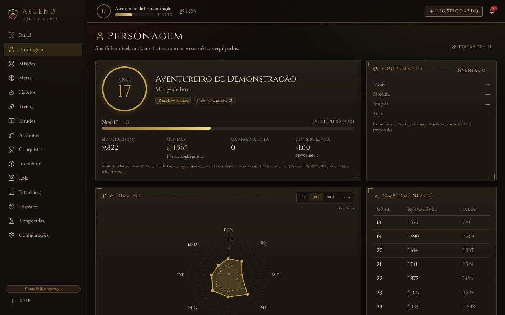
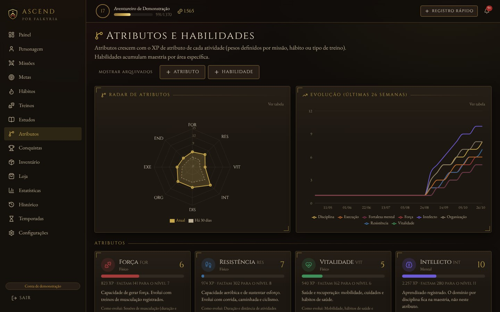
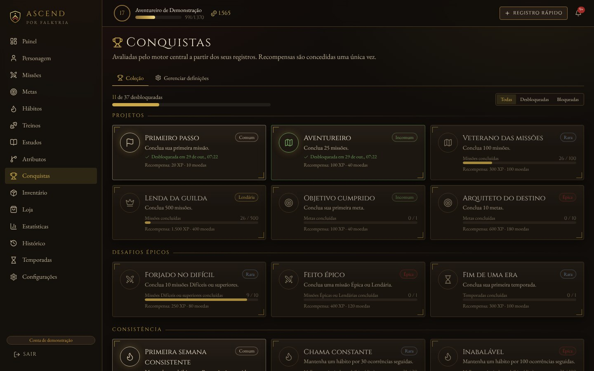
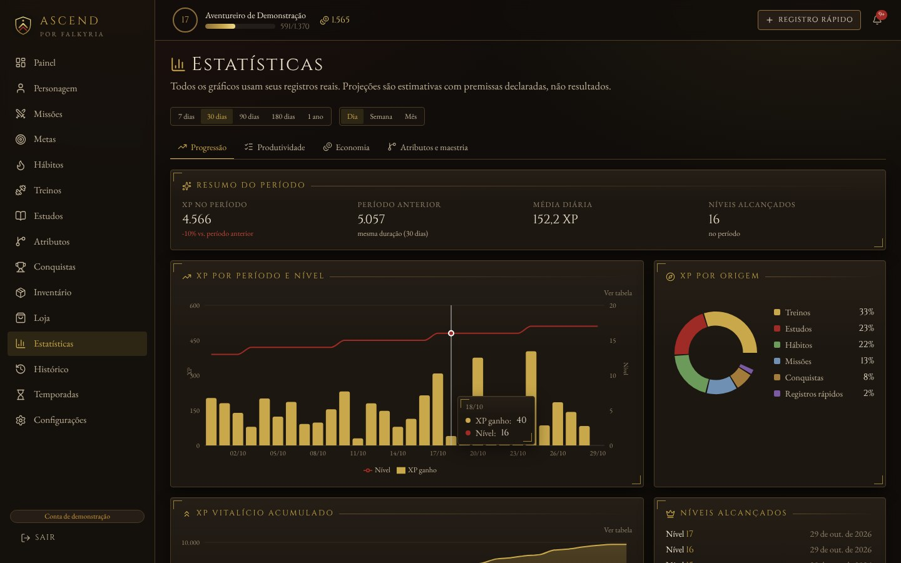
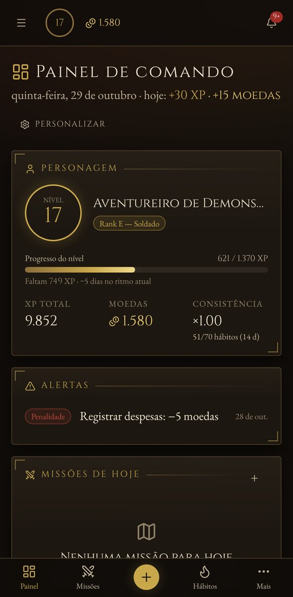
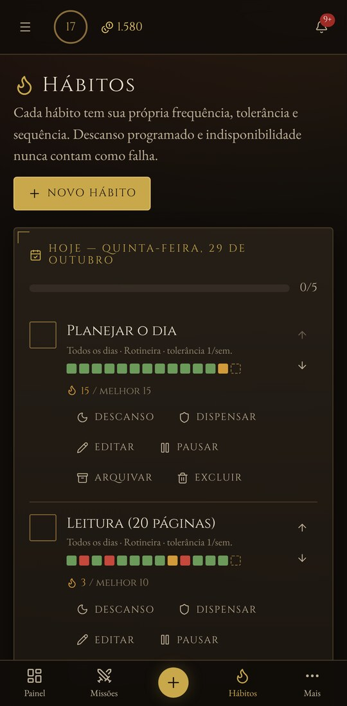
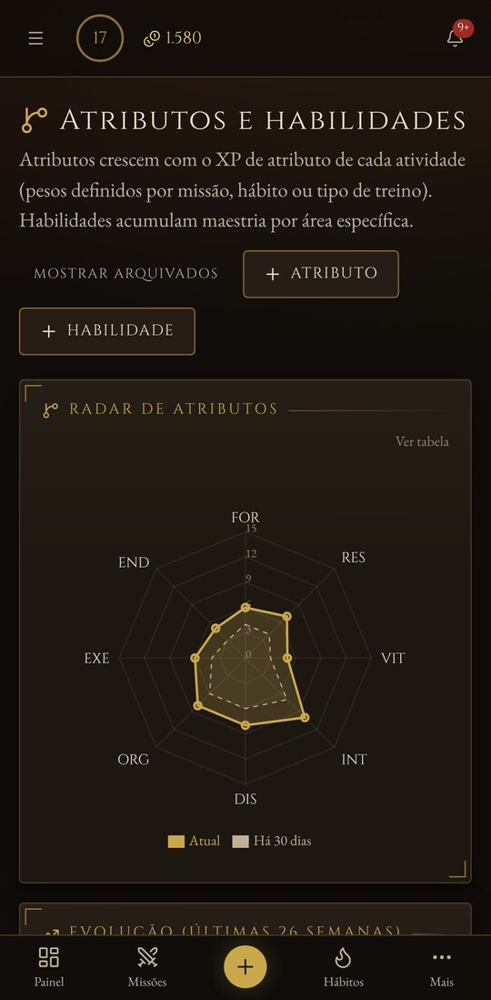

  
  
  
  

  
  
  

---

**Ascend** transforma a rotina em campanha. Cada missão concluída, hábito mantido, treino registrado e hora de estudo vira **XP**, **atributos**, **moedas** e **conquistas**. É um RPG de longo prazo, com regras honestas: tudo o que você ganha tem motivo explícito, e as penalidades são pequenas e previsíveis, nunca viram uma espiral.

  

## O que tem dentro

<table>
  <tr>
    <td width="33%" valign="top">
      <h3>⚔️ Missões</h3>
      Tarefas, desafios e projetos com dificuldade, prazo e recompensa claros. Missões recorrentes, objetivos parciais e modelos prontos.
    </td>
    <td width="33%" valign="top">
      <h3>🔥 Hábitos</h3>
      Frequência, tolerância e sequência próprias para cada hábito. Descanso programado e indisponibilidade nunca contam como falha.
    </td>
    <td width="33%" valign="top">
      <h3>🛡️ Personagem</h3>
      Nível, rank e oito atributos (Força, Resistência, Vitalidade, Intelecto, Disciplina, Organização, Execução e Fortaleza mental) que crescem com o que você faz de verdade.
    </td>
  </tr>
  <tr>
    <td valign="top">
      <h3>🏋️ Treinos e estudos</h3>
      Sessões de musculação, corrida e mobilidade, matérias, horas de estudo e avaliações, cada uma alimentando os atributos certos.
    </td>
    <td valign="top">
      <h3>🏆 Conquistas e temporadas</h3>
      Dezenas de conquistas por raridade, metas de longo prazo, temporadas com marcos e uma loja de cosméticos e recompensas.
    </td>
    <td valign="top">
      <h3>📊 Estatísticas</h3>
      XP por período e por origem, evolução dos atributos, produtividade e economia, sempre a partir dos seus registros reais.
    </td>
  </tr>
</table>

## Telas

<table>
  <tr>
    <td width="50%">
Ficha do personagem
</td>
    <td width="50%">
Atributos e evolução
</td>
  </tr>
  <tr>
    <td>
Conquistas
</td>
    <td>
Estatísticas
</td>
  </tr>
</table>

  
  &nbsp;
  
  &nbsp;
  

No celular, com navegação inferior e registro rápido. As telas mostram uma conta de demonstração com dados de exemplo.

## Instalar

### Android

1. No celular, toque em [**Baixar Ascend.apk**](https://github.com/Dracon-46/Ascend/releases/latest/download/Ascend.apk).
2. Abra o arquivo baixado. Se o Android pedir, permita instalar apps desta fonte.
3. Crie sua conta ou entre. Novas versões instalam por cima, sem perder nada.

### iPhone e computador

Abra [**falkyria-ascend.onrender.com**](https://falkyria-ascend.onrender.com). No iPhone, toque em Compartilhar → **Adicionar à Tela de Início** para usar como app. No computador, o Chrome e o Edge oferecem **Instalar** na barra de endereço.

> O servidor gratuito dorme quando ninguém usa. Se o primeiro acesso do dia demorar até um minuto, é ele acordando.

## Seus dados

- **Cada conta vê só os próprios dados.** Personagem, missões, hábitos e histórico ficam no servidor, ligados à sua conta, e acompanham você em qualquer aparelho.
- **Senha guardada só como hash**, sessão em cookie seguro e proteção contra CSRF.
- **Nada de dados falsos misturados aos seus.** A demonstração usa uma conta separada e identificada.

## Versões

Cada versão sai em [**Releases**](https://github.com/Dracon-46/Ascend/releases) com o APK versionado (`Ascend-vX.Y.Z.apk`) e a cópia fixa `Ascend.apk`, que sempre aponta para a mais recente.

## Sobre este repositório

Este é o repositório público de **distribuição** do Ascend: guarda o [site](https://dracon-46.github.io/Ascend/) (branch `gh-pages`), os APKs (Releases) e este README. O código-fonte é privado.

Encontrou um problema ou tem uma ideia? Abra uma [issue](https://github.com/Dracon-46/Ascend/issues).

   
  <b>Ascend</b> · um produto <b>Falkyria</b> · feito por <a href="https://github.com/Dracon-46">Arthur Gaspare Camzano</a>

